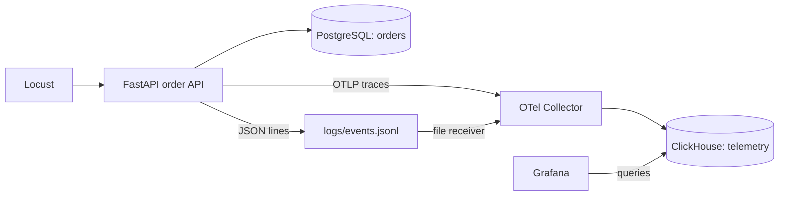

# OpenTelemetry order lookup lab

I built this to get hands-on with the ideas in *Observability Engineering*. I could explain logs and traces, but I wanted to follow an actual request through Python code, a database call, a Collector, and persistent storage.

The app is small: fetch an order for a tenant. Most of the work here is the telemetry around that operation and the experiments I ran against it.

## What I built

- A FastAPI service backed by PostgreSQL, with SQLAlchemy models and an Alembic migration.
- Automatic HTTP and SQL instrumentation, plus an `orders.lookup` business span.
- JSON completion logs carrying the active trace ID, span ID, tenant, order, and outcome.
- An OpenTelemetry Collector that receives traces over OTLP/HTTP and tails the JSON log file.
- ClickHouse storage for spans and logs, queried through Grafana.
- A Locust workload that checks successful lookups and rejected cross-tenant requests.



One order request produces a trace like this. Connection acquisition may add another database span.

```text
GET /api/v1/orders/{order_id}
└── orders.lookup
    └── SELECT orders_db
```

The completion log is a separate record emitted while `orders.lookup` is active. Its IDs link it to that span. The `events` array on a span is a different thing; I am not using attached span events here.

## What I investigated

In one readiness request, the HTTP span took about 126 ms. Connection acquisition took 73.3 ms, while `SELECT 1` took 1.63 ms. There was also about 46 ms before the connection span started, which those database spans did not explain.

I repeated the workload without restarting the API. Readiness p99 dropped from 130 ms to 31 ms, while the median stayed at 8 ms. That supported connection warm-up as an explanation for part of the slow tail; it did not prove what happened inside every millisecond of connection acquisition.

The order workload completed 1,369 requests with zero failed checks: 1,241 own-tenant lookups and 128 expected cross-tenant rejections. The lookup-span counts in ClickHouse matched those two totals. The full tables and caveats are in [the investigation notes](backend/docs/investigation.md).

## Run locally

I used Windows, PowerShell, Python 3.11, uv, and Docker Desktop with Linux containers. These commands run from the repository root unless stated otherwise.

### Install and configure

```powershell
cd backend
uv sync --frozen
Copy-Item .env.example .env
New-Item -ItemType Directory -Path logs -Force | Out-Null
docker compose -f infra/docker/compose.yaml up -d
docker compose -f infra/docker/compose.yaml ps
```

On an existing checkout, keep your current `.env` instead of overwriting it. The log directory must exist before Compose starts because the Collector mounts it with `create_host_path: false`. The API creates `events.jsonl` when it starts. All passwords supplied with this lab are disposable local credentials.

Wait for PostgreSQL and ClickHouse to be healthy. Then, still in `backend`:

```powershell
uv run alembic upgrade head
uv run python -m otel_b.scripts.seed_orders --orders-per-tenant 1000
uv run uvicorn otel_b.main:app --reload
```

The seed script prints both tenant IDs and a sample order ID for each. It uses deterministic IDs and skips existing rows, so the same seed command can be repeated. I later increased the dataset to 100,000 orders per tenant while preparing a listing experiment; the load test still selects from the first 1,000.

### Endpoints

| Endpoint | Purpose |
| --- | --- |
| `GET /api/v1/health` | Process health |
| `GET /api/v1/health/ready` | Check PostgreSQL with `SELECT 1` |
| `GET /api/v1/orders/{order_id}` | Fetch an order using both order ID and tenant ID |

Open [Swagger](http://127.0.0.1:8000/docs). Use tenant A's sample order ID with `X-Tenant-ID: 11111111-1111-4111-8111-111111111111`; it should return 200. Keep the order ID and change the header to tenant B, `22222222-2222-4222-8222-222222222222`; it should return 404. A nonexistent order returns the same 404.

The tenant header is an identity simulation. Anyone can supply another value. The query checks ownership for the supplied identity, but this is not authentication or a production authorization system. The header dependency is disabled outside `local` and `test` environments.

### Grafana

Open [Grafana](http://localhost:3111), using `admin` / `local_grafana_password`.

Under **Connections → Add new connection**, add ClickHouse with:

| Setting | Value |
| --- | --- |
| Server address | `clickhouse` |
| Protocol / port | Native / `9000` |
| Secure connection | Off for this local Docker network |
| Username / password | `otel_lab` / `local_telemetry_password` |
| Default database | `otel` |

Click **Save & test**, then open Explore. [queries.sql](backend/docs/queries.sql) contains a span table query, a waterfall query, a log query, a span/log join, and a tenant/outcome breakdown. Each query says which result format to choose. Allow a few seconds for batches to arrive. Grafana's connection settings are stored in its Docker volume; they need to be added again in a fresh environment.

The host API exports to `127.0.0.1:4318`. Grafana and the Collector use `clickhouse:9000` inside the Compose network. `localhost` inside a container refers to that container.

### Load test

In another terminal, from `backend`:

```powershell
uv run locust -f load_tests/locustfile.py --host http://127.0.0.1:8000 --web-host 127.0.0.1
```

Open [Locust](http://localhost:8089). Start with 5 users, a spawn rate of 1 user/second, and a 60-second run. Record those settings with the results. Each user keeps one tenant identity and waits 1–2 seconds between tasks.

Tasks use a 9:1 weighting: roughly 90% own-tenant requests and 10% cross-tenant checks. An own-tenant 200 must contain the correct order and tenant IDs. A cross-tenant 404 is a successful check; any other status fails that check. Request names group UUID paths into two statistics rows. Changing the file requires restarting the Locust process.

### Checks and shutdown

```powershell
uv run pytest -q
uv run alembic check
```

The tests use an isolated SQLite database to check the API's tenant filter, input validation, business span, and correlated log. PostgreSQL, Collector export, and ClickHouse storage are checked separately against the running local stack. The tests are not a PostgreSQL performance benchmark.

Stop the API and Locust with Ctrl+C. Stop the containers from `backend`:

```powershell
docker compose -f infra/docker/compose.yaml down
```

Named volumes retain database and Grafana data. Raw logs, `.env`, and virtual environments are ignored by Git.

## Code and notes

```text
backend/
  src/otel_b/
    api/                    # route wiring and dependencies
    core/                   # settings and JSON logging
    infrastructure/db/      # engine, sessions, model base
    infrastructure/telemetry/
    modules/orders/         # model, repository, service, router, response schema
    scripts/seed_orders.py
  migrations/
  infra/docker/compose.yaml
  infra/otel/collector.yaml
  load_tests/locustfile.py
  tests/
  docs/
```

[Domain and telemetry fields](backend/docs/ontology.md) · [Investigation notes](backend/docs/investigation.md) · [Grafana queries](backend/docs/queries.sql)

## Where I stopped

This is a local tracing and log-correlation lab. It has one instrumented application and database client spans; I have not demonstrated propagation between two application services. The Collector has in-memory export queues and retries, but no durable queue or persistent file checkpoints. Restarting it can replay log lines because the file receiver starts at the beginning. ClickHouse retention is configured to 72 hours, with expiration handled asynchronously by its TTL processing.

CPU/memory metrics, SLOs, sampling experiments, pipeline recovery tests, and production authentication are future work. The repository includes an unused newest-orders query, but no listing route, index comparison, or completed slow-query optimization. I plan to revisit the remaining topics in an AI project with retrieval, model calls, and tool execution.
